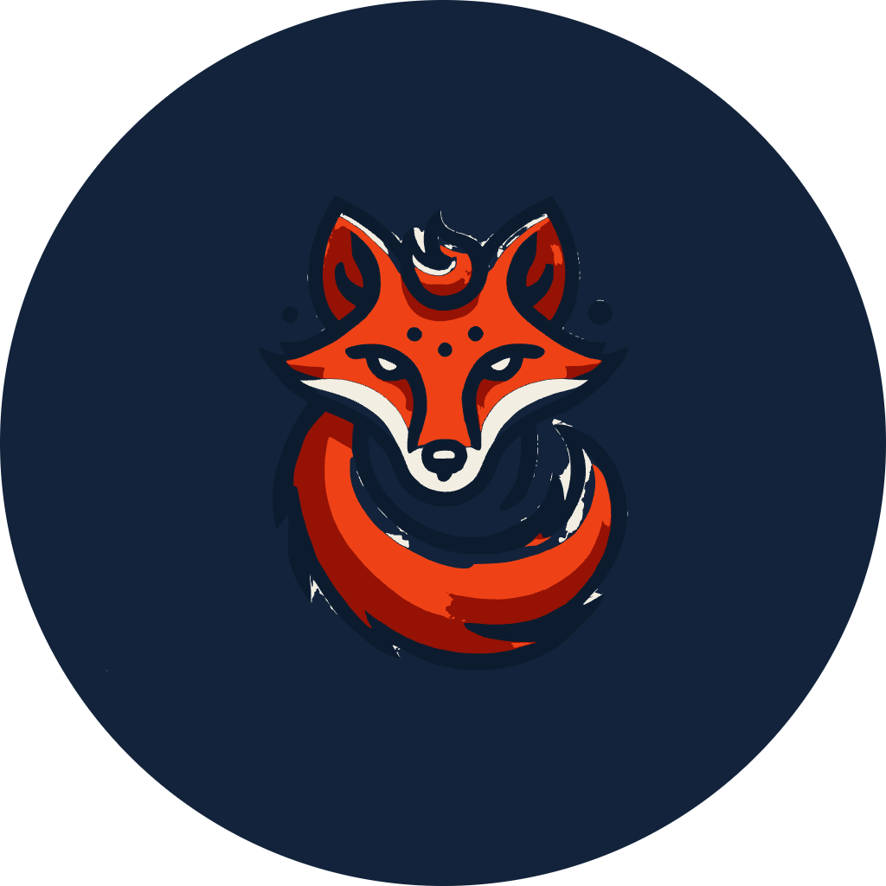

  

<h1 align="center">Gilles Fauvie</h1>

  Infra & DevOps engineer. Airport IT by day, open source by night. 
  Linux, PostgreSQL, Go, Docker, Ansible. Red Bull, not coffee. Belgium.

  <a href="https://stranix.net">stranix.net</a> ·
  <a href="https://apps.stranix.net">apps.stranix.net</a> ·
  <a href="https://x.com/stranix_79">@stranix_79</a> ·
  <a href="https://code79.com">CODE79</a>

---

I keep an airport's systems running during the day. At night I build small, sharp tools: one binary, no framework, readable by a sysadmin with a text editor. Everything here is free to read, most of it is free to use.

## What I am building

| | |
|---|---|
| [**Deckhand**](https://github.com/stranix79/deckhand) | Present a folder of HTML slides: a stage on the big screen, a remote on your phone, a live link for the audience. One Go binary, MIT. [deckhand.show](https://deckhand.show) |
| [**OmSaver**](https://github.com/stranix79/omsaver) | A TUI screensaver for macOS with real system stats and Omarchy vibes. The free half of the OmSuite. |
| **OmSuite** | OmFi, OmDash, OmWin: small native macOS apps that make a Mac feel like a tiling WM. [om.stranix.net](https://om.stranix.net) |
| [**Stranix IP**](https://github.com/stranix79/stranix-ip) | `curl ip.stranix.net`, a browser extension and a Mac app around one tiny API. |
| [**Chutag**](https://github.com/stranix79/chutag) | QR tags to get your lost things back. [chutag.be](https://chutag.be) |
| [**Kaboom**](https://github.com/stranix79/kaboom) | A multiplayer Bomberman remake, playable in two clicks. |
| [**Sygnet**](https://sygnet.app) | Bookmark sync that really includes Safari. |

## Teaching, in French

| | |
|---|---|
| [**asm-m1**](https://github.com/stranix79/asm-m1) | ARM64 assembly on Apple Silicon: 13 chapters, 11 tested labs. |
| [**cours-python**](https://github.com/stranix79/cours-python) | Python from zero to FastAPI, for people who already code: 22 chapters, 21 labs. |
| [**cours-go**](https://github.com/stranix79/cours-go) | Go from zero to production: 17 chapters, 16 labs, and when to pick Go at all. |
| [**cheatsheets**](https://github.com/stranix79/cheatsheets) | Printable A4 cheatsheets, FR and EN. First one: Omarchy keyboard shortcuts. |

## How I work

- Single binaries, embedded assets, no build step for the front end.
- Code and commits in English, courses in French, comments written for the person who will read them in two years.
- Everything deployed with Docker Compose and a git pull. If it is not in git, it does not exist.

## Support

If one of these tools lives on your machine: [GitHub Sponsors](https://github.com/sponsors/stranix79), [Ko-fi](https://ko-fi.com/stranix) (a Red Bull, not a coffee), or [stranix.net/soutenir](https://stranix.net/soutenir/).
